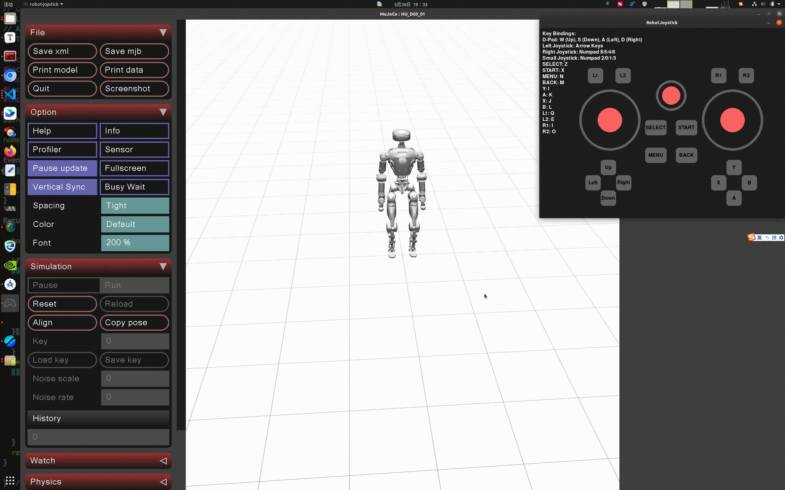
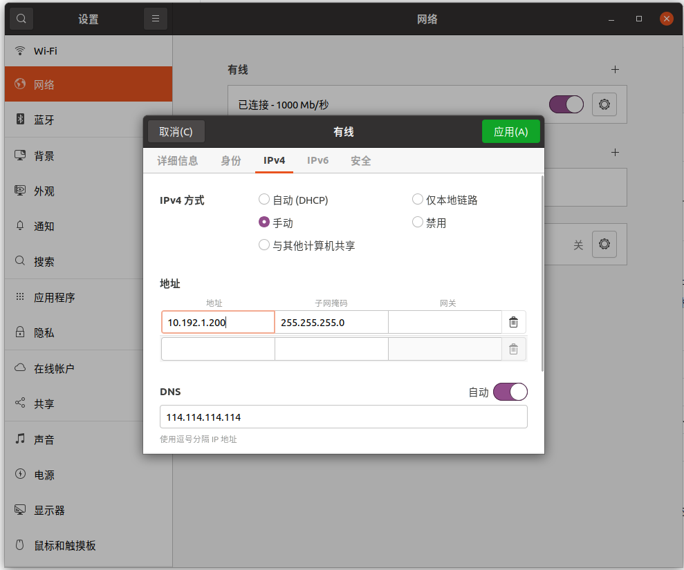
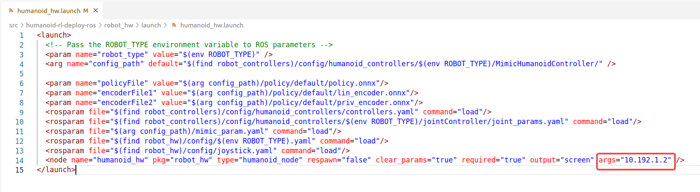

<p align="center">
  <b>English</b> | <a href="README_cn.md">中文</a>
</p>

# Deployment of Training Results

Deploy trained reinforcement-learning policies on the LimX humanoid robots
(`HU_D03_03`, `HU_D04_01`), either in MuJoCo simulation or on the real robot,
under ROS Noetic.

## 1. Deployment Environment Configuration

- **Install ROS Noetic.** We recommend setting up the algorithm development
  environment on Ubuntu 20.04 with ROS Noetic. ROS provides a set of tools and
  libraries that greatly facilitate the development, testing and deployment of
  robot algorithms.

  - Follow https://wiki.ros.org/noetic/Installation/Ubuntu and select
    `ros-noetic-desktop-full`.

  - Once ROS Noetic is installed, run the following in a Bash terminal to
    install the libraries the development environment depends on:

    ```
    sudo apt-get update
    sudo apt install ros-noetic-urdf \
                     ros-noetic-kdl-parser \
                     ros-noetic-urdf-parser-plugin \
                     ros-noetic-hardware-interface \
                     ros-noetic-controller-manager \
                     ros-noetic-controller-interface \
                     ros-noetic-robot-state-* \
                     ros-noetic-joint-state-* \
                     ros-noetic-controller-manager-msgs \
                     ros-noetic-control-msgs \
                     ros-noetic-ros-control \
                     ros-noetic-gazebo-* \
                     ros-noetic-rqt-gui \
                     ros-noetic-rqt-controller-manager \
                     ros-noetic-plotjuggler* \
                     ros-noetic-joy-teleop ros-noetic-joy \
                     cmake build-essential libpcl-dev libeigen3-dev libopencv-dev libmatio-dev \
                     python3-pip libboost-all-dev libtbb-dev liburdfdom-dev liborocos-kdl-dev -y
    ```

- **Install the ONNX Runtime dependency.** Download it from
  https://github.com/microsoft/onnxruntime/releases/tag/v1.10.0, choosing the
  build that matches your operating system and platform. For Ubuntu 20.04
  x86_64:

  ```
  wget https://github.com/microsoft/onnxruntime/releases/download/v1.10.0/onnxruntime-linux-x64-1.10.0.tgz

  tar xvf onnxruntime-linux-x64-1.10.0.tgz

  sudo cp -a onnxruntime-linux-x64-1.10.0/include/* /usr/include
  sudo cp -a onnxruntime-linux-x64-1.10.0/lib/* /usr/lib
  ```

## 2. Create a Workspace

Create an RL deployment workspace as follows:

- Create a directory to hold the workspace, for example `limx_ws` in your home
  directory:

  ```bash
  mkdir -p ~/limx_ws
  ```

- Download the MuJoCo simulator:

  ```bash
  cd ~/limx_ws

  # Option 1: HTTPS
  git clone --recurse https://github.com/limxdynamics/humanoid-mujoco-sim.git

  # Option 2: SSH
  git clone --recurse git@github.com:limxdynamics/humanoid-mujoco-sim.git
  ```

- Download the motion control algorithm:

  ```bash
  cd ~/limx_ws

  # Option 1: HTTPS
  git clone --recurse https://github.com/limxdynamics/humanoid-rl-deploy-ros.git

  # Option 2: SSH
  git clone --recurse git@github.com:limxdynamics/humanoid-rl-deploy-ros.git
  ```

- Set the robot model, if it has not been set yet:

  - List the available robot types (`tree` comes from `sudo apt install tree`
    if the command is missing):

    ```
    cd ~/limx_ws/humanoid-rl-deploy-ros/src
    tree -L 1 -P "humanoid_controllers" humanoid-rl-deploy-ros/robot_controllers/config/humanoid_controllers
    humanoid-rl-deploy-ros/robot_controllers/config/humanoid_controllers
    ├── HU_D03_03
    └── HU_D04_01
    ```

  - Taking `HU_D04_01` as an example (substitute your actual robot type):

    ```
    echo 'export ROBOT_TYPE=HU_D04_01' >> ~/.bashrc && source ~/.bashrc
    ```

## 3. Simulation Debugging

Each step below runs in its own Bash terminal. Every new terminal needs the ROS
environment first, so run this once per terminal before any ROS command in this
section or the next — their command blocks do not repeat it:

```bash
# If Conda is installed, temporarily disable it, because Conda interferes with
# the ROS environment settings.
conda deactivate

# Set up the ROS environment.
source /opt/ros/noetic/setup.bash
```

- **Run the MuJoCo simulator** (Python 3.8 or newer recommended):

  - Install the motion control development library.

    For Linux x86_64:

    ```bash
    cd ~/limx_ws
    pip install humanoid-mujoco-sim/limxsdk-lowlevel/python3/amd64/limxsdk-*.whl
    ```

    For Linux aarch64:

    ```bash
    cd ~/limx_ws
    pip install humanoid-mujoco-sim/limxsdk-lowlevel/python3/aarch64/limxsdk-*.whl
    ```

  - Run the simulator:

    ```bash
    cd ~/limx_ws
    python humanoid-mujoco-sim/simulator.py
    ```

- **Run the algorithm:**

  - Go to your workspace and compile:

    ```bash
    cd ~/limx_ws/humanoid-rl-deploy-ros
    catkin_make install
    ```

  - Start it:

    ```bash
    cd ~/limx_ws/humanoid-rl-deploy-ros
    source install/setup.bash
    roslaunch robot_hw humanoid_hw_sim.launch
    ```

    

- **Virtual joystick.** You can drive the robot with a virtual joystick while
  the simulation is running.

  - Start the virtual joystick:

    ```
    ~/limx_ws/humanoid-mujoco-sim/robot-joystick/robot-joystick
    ```

    

  - You can now control the robot with it:

    | **Button** | **Mode** | **Description** |
    | -------- | ---------------- | ----------------------------------------------------------- |
    | L1+Y | Switch to Stand Mode | If the robot cannot stand, click "Reset" in the MuJoCo interface to reset it. |
    | L1+B | Switch to Greeting Mode | |

## 4. Real Robot Debugging

- **Set your computer's IP.** Make sure your computer is connected to the robot
  through the external network port, set its IP address to `10.192.1.200`, and
  verify connectivity with `ping 10.192.1.2`:

  

- **Point the launch file at the robot.** Go to your workspace, open
  `humanoid_hw.launch` and set the robot's IP address to `10.192.1.2`:

  

- **Recompile** so that the edited launch file is installed:

  ```bash
  cd ~/limx_ws/humanoid-rl-deploy-ros
  catkin_make install
  ```

- **Prepare the robot:**

  - Hang the robot using the hooks on its left and right shoulders.
  - Power it on, then press the `right joystick` button on the remote control to
    start the robot's motors.
  - Press `R1 + DOWN` to switch to developer mode, where you can develop your own
    motion control algorithms. (This setting stays in effect after the next
    startup; press `R1 + LEFT` to exit developer mode.)

- **Deploy and run.** Start the control algorithm in a Bash terminal:

  ```bash
  cd ~/limx_ws/humanoid-rl-deploy-ros
  source install/setup.bash
  roslaunch robot_hw humanoid_hw.launch
  ```

- Press `L1 + △` on the remote control to make the robot enter standing mode.

- Press `L1 + 〇` on the remote control to make the robot greet.
