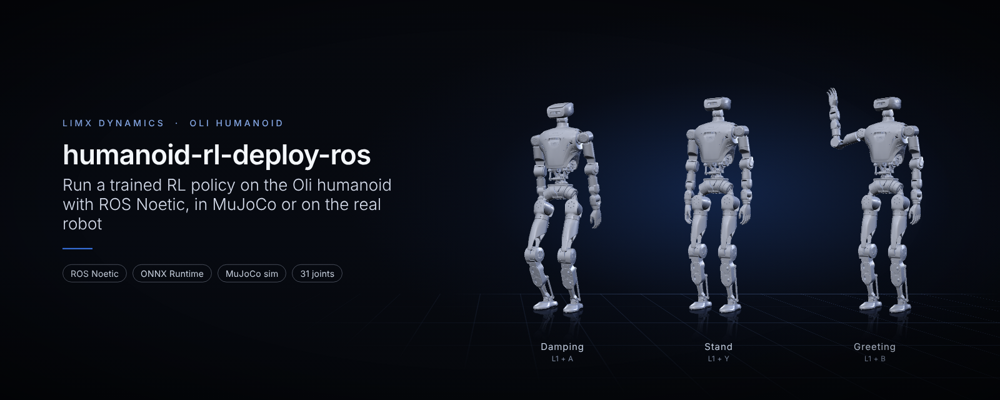
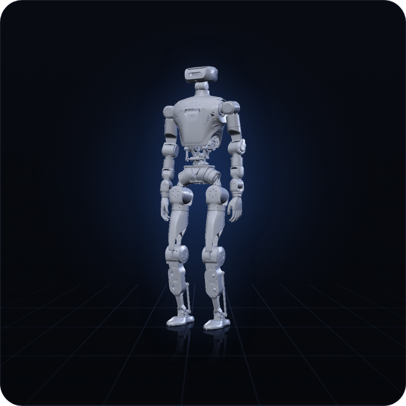
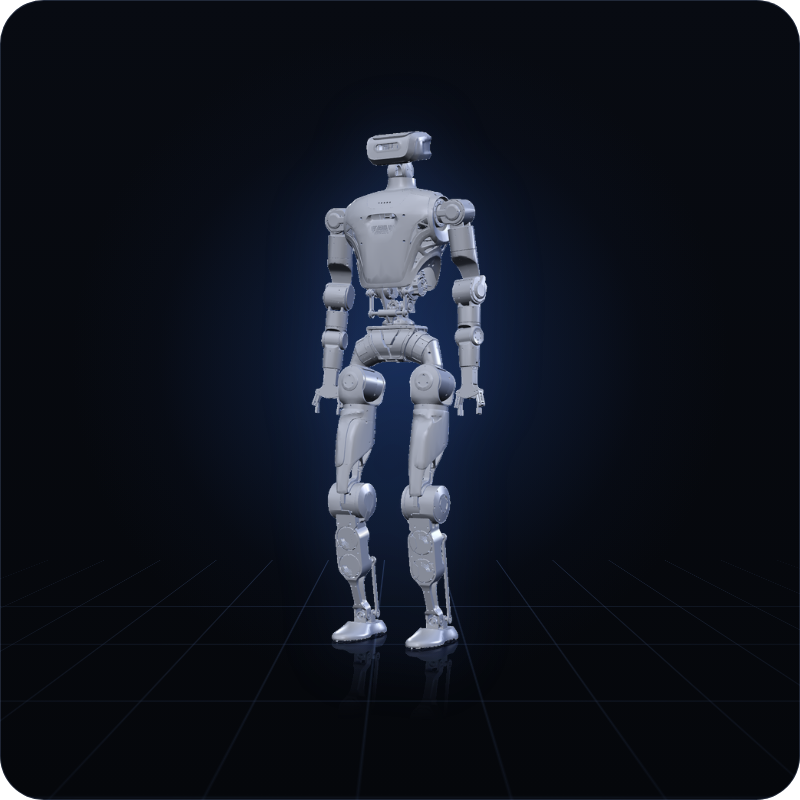
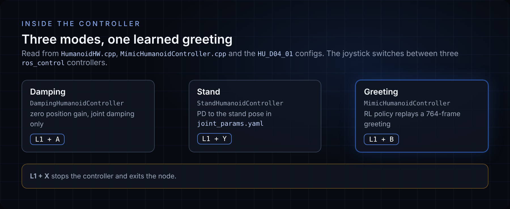
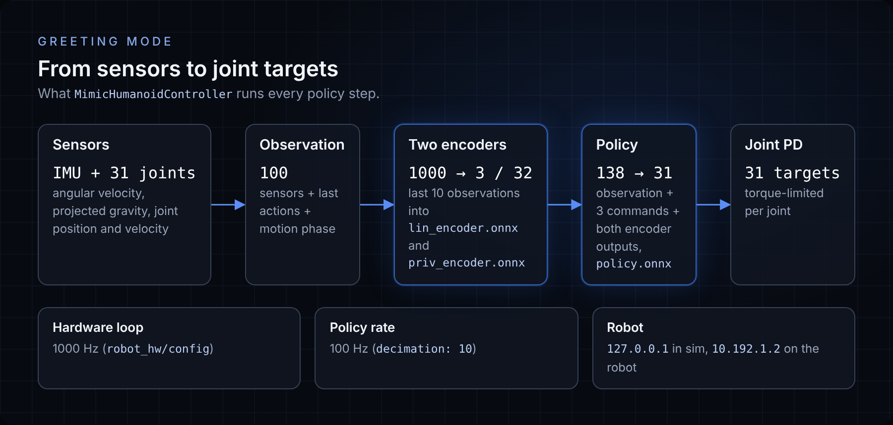
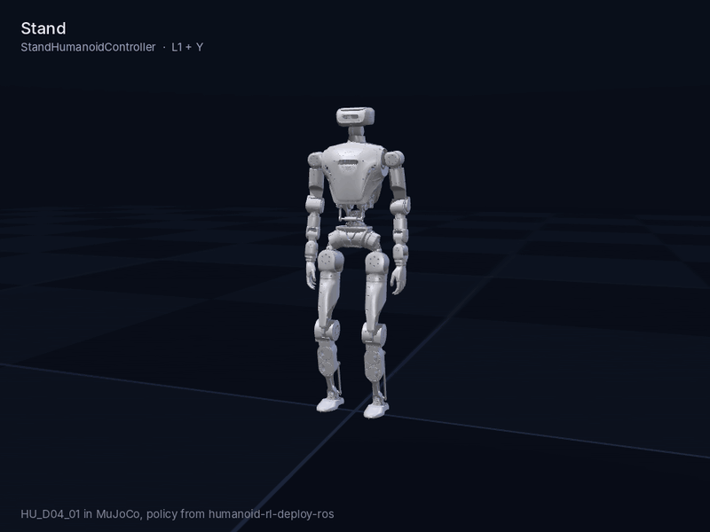
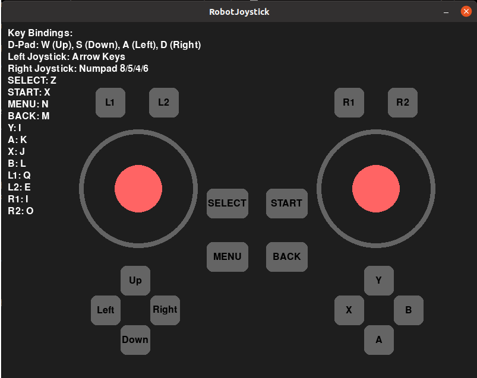
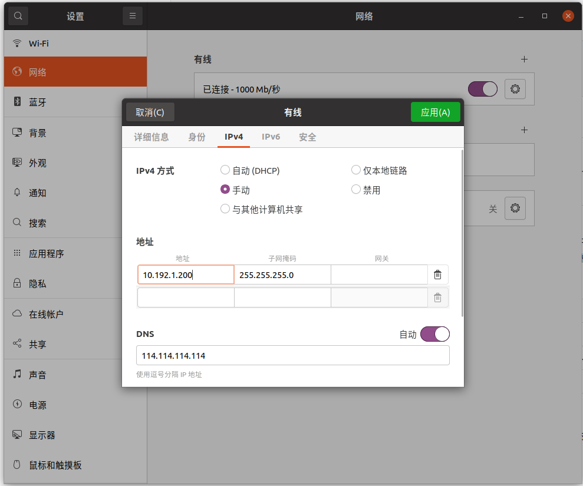

<p align="center">
  
</p>

<p align="center">
  <b>English</b> | <a href="README_cn.md">中文</a>
</p>

<p align="center">
  <a href="LICENSE"></a>
  
  
  
  <a href="https://github.com/limxdynamics/limxdynamics/blob/main/doc/wechat_qr.png"></a>
</p>
<p align="center"><sub>For partnership and procurement inquiries, contact <a href="mailto:opensource@limxdynamics.com">opensource@limxdynamics.com</a></sub></p>

# Deployment of Training Results

> **Part of the Oli humanoid open-source ecosystem.** Where to start and the other Oli repositories: [Oli quick start](https://github.com/limxdynamics/limxdynamics/blob/main/doc/quickstart.md#oli).

Deploy trained reinforcement-learning policies on the LimX humanoid robots
(`HU_D03_03`, `HU_D04_01`), either in MuJoCo simulation or on the real robot,
under ROS Noetic.

## Highlights

- **A trained policy is included.** Each robot type ships an ONNX policy and two encoders that drive all 31 joints; no training needed to see it move.
- **Same controllers in sim and on the robot.** `humanoid_hw_sim.launch` connects to [`humanoid-mujoco-sim`](https://github.com/limxdynamics/humanoid-mujoco-sim) on `127.0.0.1`; `humanoid_hw.launch` connects to the robot at `10.192.1.2`.
- **Three modes on the joystick.** Damping, stand and an RL greeting motion are separate `ros_control` controllers, switched with `L1` combinations; `L1 + X` stops everything.
- **A clean starting point for your own controller.** Add a controller next to `StandHumanoidController` and `MimicHumanoidController` in `robot_controllers` and register it in `controllers.yaml`.

## Robot models

| | Model | Description | Actuated DoF | `ROBOT_TYPE` |
| :-: | --- | --- | :-: | --- |
|  | **Oli (HU_D04)** | Full-size humanoid: 6-DoF legs, 3-DoF waist, 2-DoF head, 7-DoF arms | 31 | `HU_D04_01` |
|  | **HU_D03** *(discontinued)* | Previous-generation full-size humanoid, also 31 actuated joints | 31 | `HU_D03_03` |

Joint counts come from `robot_hw/config/<ROBOT_TYPE>.yaml`. Images are rendered from the MuJoCo models in [`humanoid-description`](https://github.com/limxdynamics/humanoid-description) with the same camera and lighting.

## How it works

<p align="center">
  
</p>

<p align="center">
  
</p>

## Set up and run

### 1. Deployment Environment Configuration

- **Install ROS Noetic.** We recommend setting up the algorithm development
  environment on Ubuntu 20.04 with ROS Noetic. ROS provides a set of tools and
  libraries that greatly facilitate the development, testing and deployment of
  robot algorithms.

  - Follow https://wiki.ros.org/noetic/Installation/Ubuntu and select
    `ros-noetic-desktop-full`.

  - Once ROS Noetic is installed, run the following in a Bash terminal to
    install the libraries the development environment depends on:

    ```bash
    sudo apt-get update
    sudo apt install ros-noetic-urdf \
                     ros-noetic-kdl-parser \
                     ros-noetic-urdf-parser-plugin \
                     ros-noetic-hardware-interface \
                     ros-noetic-controller-manager \
                     ros-noetic-controller-interface \
                     ros-noetic-robot-state-* \
                     ros-noetic-joint-state-* \
                     ros-noetic-controller-manager-msgs \
                     ros-noetic-control-msgs \
                     ros-noetic-ros-control \
                     ros-noetic-gazebo-* \
                     ros-noetic-rqt-gui \
                     ros-noetic-rqt-controller-manager \
                     ros-noetic-plotjuggler* \
                     ros-noetic-joy-teleop ros-noetic-joy \
                     cmake build-essential libpcl-dev libeigen3-dev libopencv-dev libmatio-dev \
                     python3-pip libboost-all-dev libtbb-dev liburdfdom-dev liborocos-kdl-dev -y
    ```

- **Install the ONNX Runtime dependency.** Download it from
  https://github.com/microsoft/onnxruntime/releases/tag/v1.10.0, choosing the
  build that matches your operating system and platform. For Ubuntu 20.04
  x86_64:

  ```bash
  wget https://github.com/microsoft/onnxruntime/releases/download/v1.10.0/onnxruntime-linux-x64-1.10.0.tgz

  tar xvf onnxruntime-linux-x64-1.10.0.tgz

  sudo cp -a onnxruntime-linux-x64-1.10.0/include/* /usr/include
  sudo cp -a onnxruntime-linux-x64-1.10.0/lib/* /usr/lib
  ```

### 2. Create a Workspace

Create an RL deployment workspace as follows:

- Create a directory to hold the workspace, for example `limx_ws` in your home
  directory:

  ```bash
  mkdir -p ~/limx_ws
  ```

- Download the MuJoCo simulator:

  ```bash
  cd ~/limx_ws

  # Option 1: HTTPS
  git clone --recurse https://github.com/limxdynamics/humanoid-mujoco-sim.git

  # Option 2: SSH
  git clone --recurse git@github.com:limxdynamics/humanoid-mujoco-sim.git
  ```

- Download the motion control algorithm:

  ```bash
  cd ~/limx_ws

  # Option 1: HTTPS
  git clone --recurse https://github.com/limxdynamics/humanoid-rl-deploy-ros.git

  # Option 2: SSH
  git clone --recurse git@github.com:limxdynamics/humanoid-rl-deploy-ros.git
  ```

- Set the robot model, if it has not been set yet:

  - List the available robot types (`tree` comes from `sudo apt install tree`
    if the command is missing):

    ```
    cd ~/limx_ws/humanoid-rl-deploy-ros/src
    tree -L 1 -P "humanoid_controllers" humanoid-rl-deploy-ros/robot_controllers/config/humanoid_controllers
    humanoid-rl-deploy-ros/robot_controllers/config/humanoid_controllers
    ├── HU_D03_03
    └── HU_D04_01
    ```

  - Taking `HU_D04_01` as an example (substitute your actual robot type):

    ```bash
    echo 'export ROBOT_TYPE=HU_D04_01' >> ~/.bashrc && source ~/.bashrc
    ```

### 3. Simulation Debugging

Each step below runs in its own Bash terminal. Every new terminal needs the ROS
environment first, so run this once per terminal before any ROS command in this
section or the next — their command blocks do not repeat it:

```bash
# If Conda is installed, temporarily disable it, because Conda interferes with
# the ROS environment settings.
conda deactivate

# Set up the ROS environment.
source /opt/ros/noetic/setup.bash
```

- **Run the MuJoCo simulator** (Python 3.8 or newer recommended):

  - Install the motion control development library.

    For Linux x86_64:

    ```bash
    cd ~/limx_ws
    pip install humanoid-mujoco-sim/limxsdk-lowlevel/python3/amd64/limxsdk-*.whl
    ```

    For Linux aarch64:

    ```bash
    cd ~/limx_ws
    pip install humanoid-mujoco-sim/limxsdk-lowlevel/python3/aarch64/limxsdk-*.whl
    ```

  - Run the simulator:

    ```bash
    cd ~/limx_ws
    python humanoid-mujoco-sim/simulator.py
    ```

- **Run the algorithm:**

  - Go to your workspace and compile:

    ```bash
    cd ~/limx_ws/humanoid-rl-deploy-ros
    catkin_make install
    ```

  - Start it:

    ```bash
    cd ~/limx_ws/humanoid-rl-deploy-ros
    source install/setup.bash
    roslaunch robot_hw humanoid_hw_sim.launch
    ```

    

- **Virtual joystick.** You can drive the robot with a virtual joystick while
  the simulation is running.

  - Start the virtual joystick:

    ```
    ~/limx_ws/humanoid-mujoco-sim/robot-joystick/robot-joystick
    ```

    

  - You can now control the robot with it:

    | **Button** | **Mode** | **Description** |
    | -------- | ---------------- | ----------------------------------------------------------- |
    | L1+Y | Switch to Stand Mode | If the robot cannot stand, click "Reset" in the MuJoCo interface to reset it. |
    | L1+B | Switch to Greeting Mode | |
    | L1+A | Switch to Damping Mode | Joints are only damped; the robot will not hold itself up. |
    | L1+X | Stop | Stops the controller and exits the node. |

### 4. Real Robot Debugging

- **Set your computer's IP.** Make sure your computer is connected to the robot
  through the external network port, set its IP address to `10.192.1.200`, and
  verify connectivity with `ping 10.192.1.2`:

  

- `humanoid_hw.launch` already connects to the robot at `10.192.1.2`, so no
  launch-file change or rebuild is needed.

- **Prepare the robot:**

  - Hang the robot using the hooks on its left and right shoulders.
  - Power it on, then press the `right joystick` button on the remote control to
    start the robot's motors.
  - Press `R1 + DOWN` to switch to developer mode, where you can develop your own
    motion control algorithms. (This setting stays in effect after the next
    startup; press `R1 + LEFT` to exit developer mode.)

- **Deploy and run.** Start the control algorithm in a Bash terminal:

  ```bash
  cd ~/limx_ws/humanoid-rl-deploy-ros
  source install/setup.bash
  roslaunch robot_hw humanoid_hw.launch
  ```

- Press `L1 + △` on the remote control to make the robot enter standing mode.

- Press `L1 + 〇` on the remote control to make the robot greet.

## License

See [LICENSE](LICENSE). The bundled submodules are described in [NOTICE](NOTICE).
