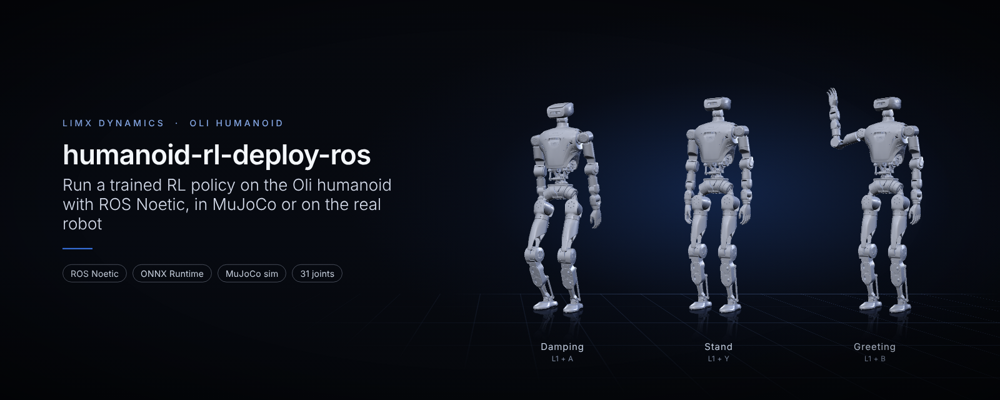
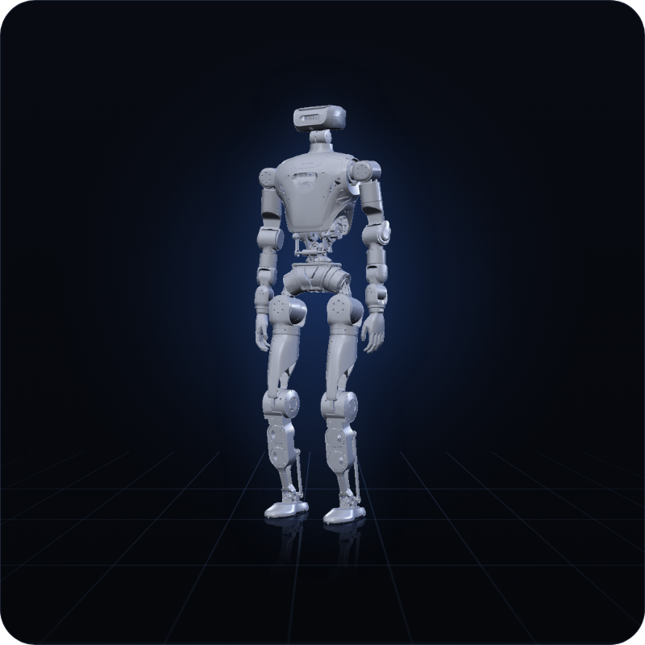
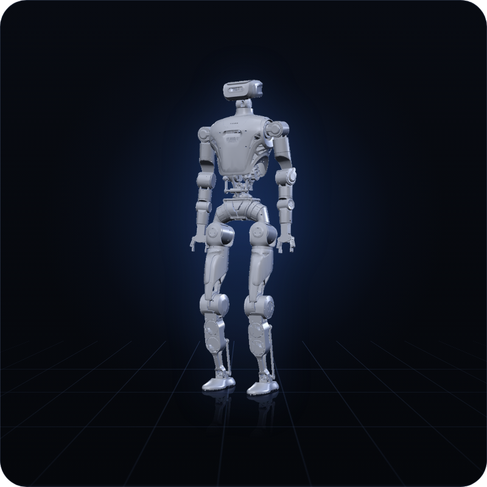
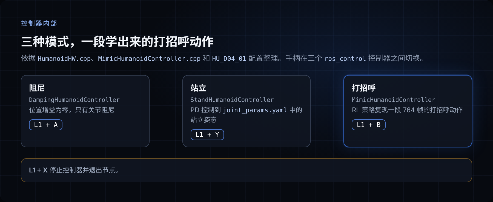
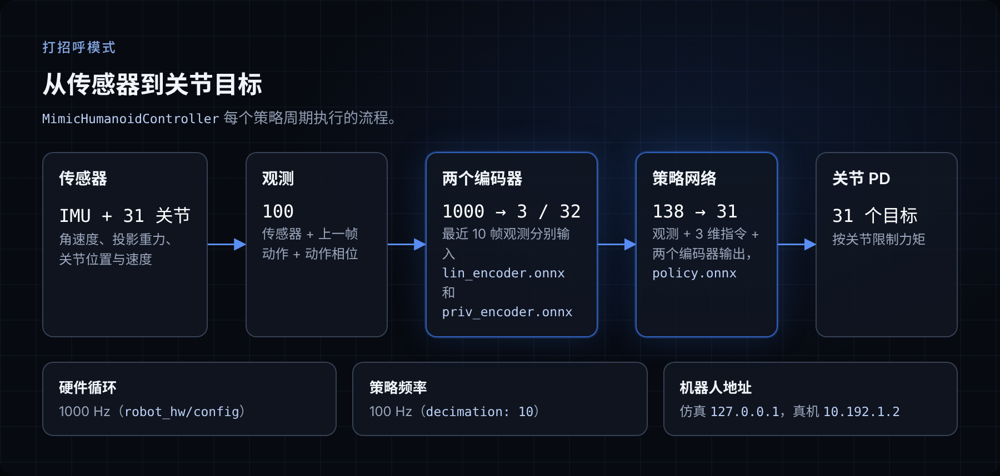
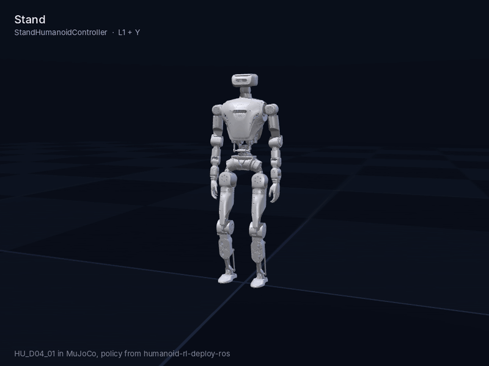
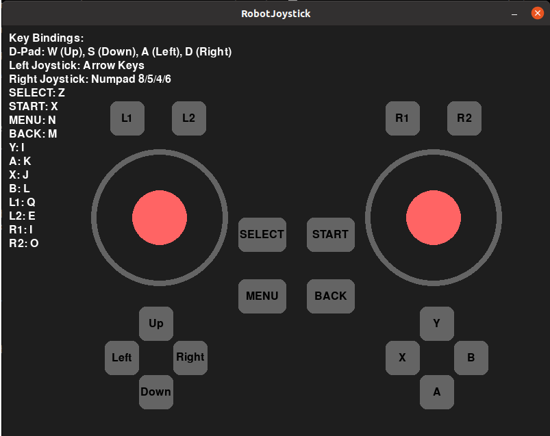
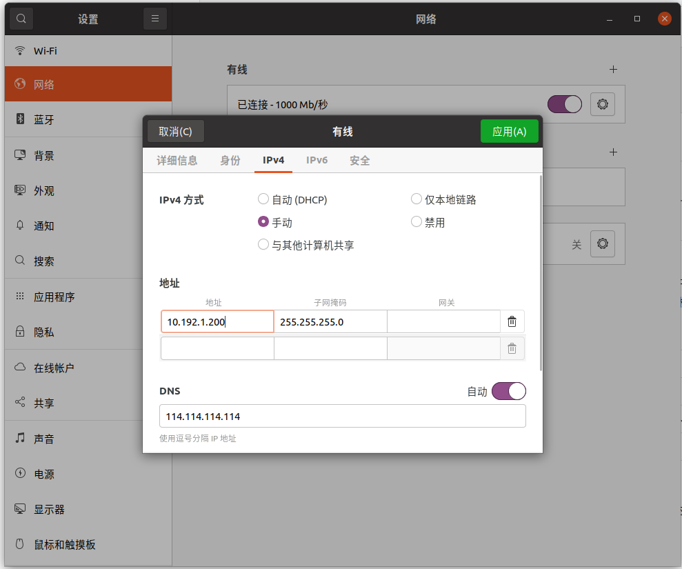

<p align="center">
  
</p>

<p align="center">
  <a href="README.md">English</a> | <b>中文</b>
</p>

<p align="center">
  <a href="LICENSE"></a>
  
  
  
  <a href="https://github.com/limxdynamics/limxdynamics/blob/main/doc/wechat_qr.png"></a>
</p>
<p align="center"><sub>合作采购请联系 <a href="mailto:opensource@limxdynamics.com">opensource@limxdynamics.com</a></sub></p>

# 训练结果部署

> **Oli 人形机器人开源生态的一部分。** 上手路线和其他 Oli 仓库：[Oli 快速上手](https://github.com/limxdynamics/limxdynamics/blob/main/doc/quickstart_cn.md#oli)。

在 ROS Noetic 下把训练好的强化学习策略部署到 LimX 人形机器人（`HU_D03_03`、
`HU_D04_01`），既可跑 MuJoCo 仿真，也可上真机。

## 亮点

- **自带训练好的策略。** 每个机器人型号都附带一个 ONNX 策略和两个编码器，驱动全部 31 个关节，无需训练就能看到机器人动起来。
- **仿真与真机同一套控制器。** `humanoid_hw_sim.launch` 连接 `127.0.0.1` 上的 [`humanoid-mujoco-sim`](https://github.com/limxdynamics/humanoid-mujoco-sim)；`humanoid_hw.launch` 连接 `10.192.1.2` 上的真机。
- **手柄切换三种模式。** 阻尼、站立和 RL 打招呼动作是三个独立的 `ros_control` 控制器，用 `L1` 组合键切换；`L1 + X` 全部停止。
- **方便扩展自己的控制器。** 在 `robot_controllers` 中仿照 `StandHumanoidController`、`MimicHumanoidController` 新增控制器，并在 `controllers.yaml` 中注册即可。

## 机器人型号

| | 型号 | 说明 | 驱动自由度 | `ROBOT_TYPE` |
| :-: | --- | --- | :-: | --- |
|  | **Oli（HU_D04）** | 全尺寸人形：腿部各 6 自由度，腰部 3、头部 2、手臂各 7 自由度 | 31 | `HU_D04_01` |
|  | **HU_D03**（已停产） | 上一代全尺寸人形，同样为 31 个驱动关节 | 31 | `HU_D03_03` |

关节数来自 `robot_hw/config/<ROBOT_TYPE>.yaml`。图片由 [`humanoid-description`](https://github.com/limxdynamics/humanoid-description) 的 MuJoCo 模型以同一相机和灯光渲染。

## 工作原理

<p align="center">
  
</p>

<p align="center">
  
</p>

## 安装与运行

### 1、部署环境配置

- **安装 ROS Noetic。** 我们推荐在 Ubuntu 20.04 上搭建基于 ROS Noetic 的算法
  开发环境。ROS 提供了一系列工具和库，极大便利了机器人算法的开发、测试和部署。

  - 安装方法请参考 https://wiki.ros.org/noetic/Installation/Ubuntu ，选择
    `ros-noetic-desktop-full` 进行安装。

  - ROS Noetic 安装完成后，Bash 终端执行以下命令安装开发环境所依赖的库：

    ```bash
    sudo apt-get update
    sudo apt install ros-noetic-urdf \
                     ros-noetic-kdl-parser \
                     ros-noetic-urdf-parser-plugin \
                     ros-noetic-hardware-interface \
                     ros-noetic-controller-manager \
                     ros-noetic-controller-interface \
                     ros-noetic-robot-state-* \
                     ros-noetic-joint-state-* \
                     ros-noetic-controller-manager-msgs \
                     ros-noetic-control-msgs \
                     ros-noetic-ros-control \
                     ros-noetic-gazebo-* \
                     ros-noetic-rqt-gui \
                     ros-noetic-rqt-controller-manager \
                     ros-noetic-plotjuggler* \
                     ros-noetic-joy-teleop ros-noetic-joy \
                     cmake build-essential libpcl-dev libeigen3-dev libopencv-dev libmatio-dev \
                     python3-pip libboost-all-dev libtbb-dev liburdfdom-dev liborocos-kdl-dev -y
    ```

- **安装 ONNX Runtime 依赖。** 从
  https://github.com/microsoft/onnxruntime/releases/tag/v1.10.0 下载，按自己的
  操作系统和平台选择对应版本。Ubuntu 20.04 x86_64 按以下步骤安装：

  ```bash
  wget https://github.com/microsoft/onnxruntime/releases/download/v1.10.0/onnxruntime-linux-x64-1.10.0.tgz

  tar xvf onnxruntime-linux-x64-1.10.0.tgz

  sudo cp -a onnxruntime-linux-x64-1.10.0/include/* /usr/include
  sudo cp -a onnxruntime-linux-x64-1.10.0/lib/* /usr/lib
  ```

### 2、创建工作空间

按以下步骤创建 RL 部署开发工作空间：

- 创建一个目录存放工作空间，例如在主目录下创建 `limx_ws`：

  ```bash
  mkdir -p ~/limx_ws
  ```

- 下载 MuJoCo 仿真器：

  ```bash
  cd ~/limx_ws

  # Option 1: HTTPS
  git clone --recurse https://github.com/limxdynamics/humanoid-mujoco-sim.git

  # Option 2: SSH
  git clone --recurse git@github.com:limxdynamics/humanoid-mujoco-sim.git
  ```

- 下载运动控制算法：

  ```bash
  cd ~/limx_ws

  # Option 1: HTTPS
  git clone --recurse https://github.com/limxdynamics/humanoid-rl-deploy-ros.git

  # Option 2: SSH
  git clone --recurse git@github.com:limxdynamics/humanoid-rl-deploy-ros.git
  ```

- 设置机器人型号，如果尚未设置：

  - 列出可用的机器人类型（若提示 `tree` 不存在，用
    `sudo apt install tree` 安装）：

    ```
    cd ~/limx_ws/humanoid-rl-deploy-ros/src
    tree -L 1 -P "humanoid_controllers" humanoid-rl-deploy-ros/robot_controllers/config/humanoid_controllers
    humanoid-rl-deploy-ros/robot_controllers/config/humanoid_controllers
    ├── HU_D03_03
    └── HU_D04_01
    ```

  - 以 `HU_D04_01` 为例（请替换为实际机器人类型）：

    ```bash
    echo 'export ROBOT_TYPE=HU_D04_01' >> ~/.bashrc && source ~/.bashrc
    ```

### 3、仿真调试

以下每个步骤各用一个终端。每个新终端在跑本节或下一节的任何 ROS 命令之前，都要
先执行一次下面的准备命令 —— 后续命令块不再重复：

```bash
# 如安装了 Conda，请临时禁用（Conda 会干扰 ROS 的环境设置）
conda deactivate

# 设置 ROS 环境
source /opt/ros/noetic/setup.bash
```

- **运行 MuJoCo 仿真器**（推荐 Python 3.8 及以上版本）：

  - 安装运动控制开发库。

    Linux x86_64 环境：

    ```bash
    cd ~/limx_ws
    pip install humanoid-mujoco-sim/limxsdk-lowlevel/python3/amd64/limxsdk-*.whl
    ```

    Linux aarch64 环境：

    ```bash
    cd ~/limx_ws
    pip install humanoid-mujoco-sim/limxsdk-lowlevel/python3/aarch64/limxsdk-*.whl
    ```

  - 运行仿真器：

    ```bash
    cd ~/limx_ws
    python humanoid-mujoco-sim/simulator.py
    ```

- **运行算法：**

  - 进入工作空间并编译：

    ```bash
    cd ~/limx_ws/humanoid-rl-deploy-ros
    catkin_make install
    ```

  - 启动算法：

    ```bash
    cd ~/limx_ws/humanoid-rl-deploy-ros
    source install/setup.bash
    roslaunch robot_hw humanoid_hw_sim.launch
    ```

    

- **虚拟遥控器。** 仿真运行期间可以用虚拟遥控器操作机器人。

  - 启动虚拟遥控器：

    ```
    ~/limx_ws/humanoid-mujoco-sim/robot-joystick/robot-joystick
    ```

    

  - 这时就可以用虚拟遥控器控制机器人了：

    | **按键** | **模式** | **说明** |
    | -------- | ---------------- | ----------------------------------------------------------- |
    | L1+Y | 切换到站立模式 | 如机器人没法站立，请点击 MuJoCo 界面中的“Reset”复位一下。 |
    | L1+B | 切换到打招呼模式 | 运行仓库自带的 RL 策略：机器人挥手约 7.6 秒（764 帧），之后保持站立。 |
    | L1+A | 切换到阻尼模式 | 关节只有阻尼，机器人无法自行站稳。 |
    | L1+X | 停止 | 停止控制器并退出节点。 |

### 4、真机调试

- **设置电脑 IP。** 确保电脑与机器人本体通过外置网口连接，把电脑 IP 设为
  `10.192.1.200`，并用 `ping 10.192.1.2` 确认能正常 ping 通：

  

- `humanoid_hw.launch` 默认已连接 `10.192.1.2` 上的机器人，无需修改启动文件或重新编译。

- **机器人准备：**

  - 通过机器人左右肩膀的挂钩把机器人吊起来。
  - 按电源键开机后，按下遥控器 `右摇杆` 按键，启动机器人电机。
  - 按下遥控器按键 `R1 + DOWN` 切换到开发者模式，在此模式下可以开发自己的运动
    控制算法。（此模式设置后下次开机继续生效，如需退出请按 `R1 + LEFT`。）

- **实机部署运行。** 在 Bash 终端启动控制算法：

  ```bash
  cd ~/limx_ws/humanoid-rl-deploy-ros
  source install/setup.bash
  roslaunch robot_hw humanoid_hw.launch
  ```

- 这时可以通过遥控器按键 `L1 + △` 让机器人进入站立模式。

- 遥控器按 `L1 + 〇` 控制机器人打招呼。

## 许可证

见 [LICENSE](LICENSE)。随附的子模块说明见 [NOTICE](NOTICE)。
